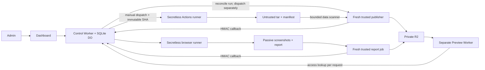

# BYGA Universal Repo Preview

Dashboard pribadi untuk menganalisis repo GitHub publik, membangun output statis lewat GitHub Actions, dan menampilkannya lewat Preview Worker terpisah. **Rebuild hanya atas aksi admin.** Runtime backend pihak ketiga tidak dideploy.

Implementasi ini berisi source aplikasi, workflow produksi, scanner artefak, fixture lokal, pengujian dan panduan setup. Belum ada deployment live atau resource cloud yang dibuat oleh task ini. External builds dan login produksi default **disabled** sampai setup serta security/CPU gates selesai.

## Jalankan lokal

Prasyarat: Node 22.12+/24, pnpm 10.28.2, Python 3.11+, Chromium Playwright.

```sh
corepack enable
corepack prepare pnpm@10.28.2 --activate
pnpm install --frozen-lockfile
pnpm exec playwright install --with-deps chromium
pnpm dev
```

Buka `http://127.0.0.1:5173`. Password **khusus fixture lokal**: `byga-local-fixture-only`; ganti dengan `BYGA_LOCAL_PASSWORD` bila perlu. Preview berjalan pada origin berbeda `http://127.0.0.1:8788`. Data lokal bersifat sementara. Jangan gunakan server fixture sebagai deployment.

Gunakan URL fixture berikut pada form:

- `https://github.com/fixture/html`: HTML/CSS/JS interaktif.
- `https://github.com/fixture/vite`: output Vite yang benar-benar dibuild.
- `https://github.com/fixture/monorepo`: pilih `apps/web`; kandidat lain `apps/docs`.
- `https://github.com/fixture/broken`: simulasi runner gagal dengan diagnostik.
- `https://github.com/fixture/private`: ditolak.

URL tersebut adalah **metadata mock lokal**, bukan klaim repository publik/live deployment. Runtime API, SQLite DO, R2 lokal, scanner tar, serving Worker, sesi, HMAC callback dan screenshot browser memakai implementasi nyata. Provider GitHub/Actions diganti mock lewat outbound service Miniflare, tanpa jalur bypass di source produksi. Fixture output diproses oleh `produce` dan `validate_tar` yang sama dengan pipeline.

Jika browser sistem sudah tersedia, set `PLAYWRIGHT_EXECUTABLE_PATH=/usr/bin/chromium` untuk `pnpm dev` dan `pnpm test:e2e`. Di lingkungan ini browser download dibatasi jaringan; browser sistem digunakan untuk QA.

## Verifikasi

```sh
pnpm check
pnpm test:e2e
pnpm types:workers
pnpm exec wrangler deploy --config apps/control-worker/wrangler.jsonc --dry-run --outdir .local/control
pnpm exec wrangler deploy --config apps/preview-worker/wrangler.jsonc --dry-run --outdir .local/preview
```

Lihat [hasil dan batas verifikasi](docs/VALIDATION.md). Screenshot QA dibuat di `test-results/` (gitignored). CI menjalankan typecheck, lint, unit/integration Python/TypeScript, validasi workflow, build dashboard dan Playwright.

## Struktur dan alur

| Modul | Tanggung jawab |
|---|---|
| `apps/dashboard` | React/Vite mobile-first, admin login, source/ref/app/config, queue/logs, iframe, retention, rebuild/validate/delete |
| `apps/control-worker` | API same-origin, server-side sessions, satu SQLite DO koordinator, alarm monitoring/cleanup, immutable run bindings |
| `apps/preview-worker` | R2 private, origin terpisah, access lookup setiap request, noindex/CSP, URL revoke/expire |
| `packages/shared` | Zod schemas, tipe, fingerprint, sanitasi, auth/HMAC |
| `packages/repo-analyzer` | URL GitHub/ref SHA/monorepo/candidate/static profiles |
| `packages/build-manifest` | Manifest v1 dan allowlist path/MIME |
| `scripts` | Secretless source build, passive trusted publisher, browser QA, setup lokal |
| `.github/workflows` | CI, build-untrusted, publish-trusted, preview-validation |



Control memonitor job yang sudah dimulai. Tidak ada webhook sumber, polling ref upstream berkala, atau scheduled rebuild. SQL menyimpan record bertipe dengan indeks status/cache/expiry; registry sesi, login limits, nonces dan audit disimpan terpisah. Riwayat API dibatasi 200 record terbaru; file preview permanen tidak dihapus hanya karena keluar dari tampilan riwayat.

## Setup cloud

Ikuti [DEPLOY](docs/DEPLOY.md), [inventory secrets/permissions](docs/SECRETS.md), [security](docs/SECURITY.md), [compatibility](docs/COMPATIBILITY.md), [costs](docs/COSTS.md), dan [runbook](docs/RUNBOOK.md). Gunakan akun/repo orkestrasi sendiri; jangan mengisi secrets di repo target publik.

Produksi memakai Worker dashboard/API dengan SQLite DO, Worker preview terpisah dan satu R2 Standard private bucket. Tidak wajib D1 atau platform berbayar. Konfigurasi Cloudflare, izin Actions, DNS/TLS, password-KDF CPU serta dua repo publik live harus diverifikasi pada akun Anda sebelum external builds diaktifkan.

## Batas rilis ini

Static HTML dan Vite memiliki fixture end-to-end. Framework lain memakai profil konservatif atau konfigurasi manual dan perlu validasi per repo. Next/Nuxt/SvelteKit runtime tetap `unsupported-runtime`. Bun belum tersedia pada runner; gunakan npm/pnpm atau Yarn yang kompatibel. Tidak ada auto-retry source/dependency/security errors; retry manual satu kali, pinned SHA. Settings batas resource sengaja read-only; ubah lewat review kode. Full runner logs dibuka melalui link Actions authenticated dari logs API; UI menyimpan timeline diagnostik yang sudah disanitasi. Tidak ada public R2 bucket, CDN cache preview, shared untrusted dependency cache, auto-update upstream atau jaminan kompatibilitas/gratis 100%.
